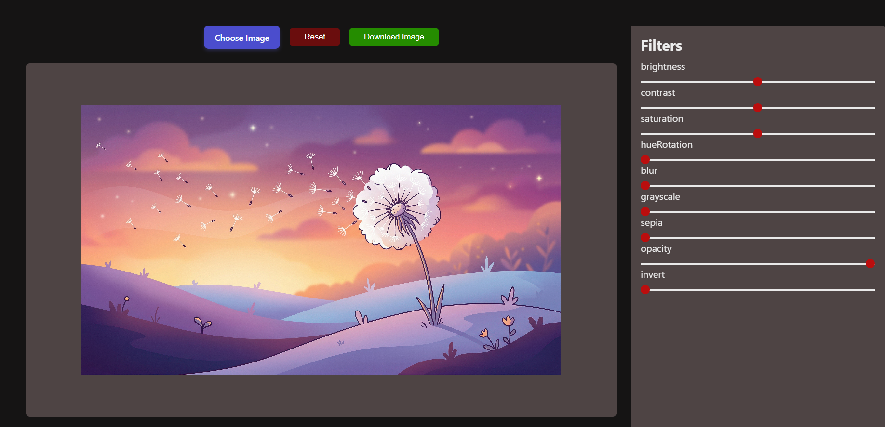
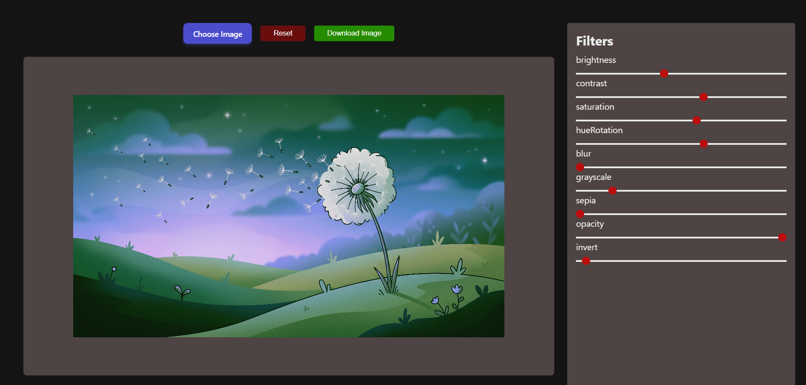

# 📸 Web-Based Image Editor




A sleek, responsive, and client-side photo editing web application built with **Vanilla JavaScript**, **HTML5 Canvas API**, and **CSS3**. It enables users to apply real-time adjustments, switch between curated aesthetic presets, and download high-resolution edited images directly from the browser.

---

## ✨ Features

- **Real-Time Canvas Rendering:** Instantly apply and preview changes without lag using the HTML5 Canvas API and native CSS filters.
- **Dynamic Filter Controls:** Automatically generates range sliders for 9 adjustable properties:
  - Brightness, Contrast, Saturation, Hue Rotation, Blur, Grayscale, Sepia, Opacity, and Invert.
- **Curated Presets:** Includes 11 built-in professional color grading presets (Vintage, Cyberpunk, Cinematic, Black & White, Dreamy, Fade, Warmth, Cool, Dramatic, Invert, and Normal) generated dynamically.
- **Instant Export:** Export and download your edited creation instantly as a PNG.
- **Responsive Dark Mode UI:** Designed with a modern dark theme layout optimized for desktop and mobile screens.

---

## 🛠️ Tech Stack

- **HTML5** (Canvas API & File API)
- **CSS3** (Modern Flexbox, Custom Styling & Variables)
- **JavaScript (ES6+)** (DOM Manipulation, Dynamic Element Generation & Event Handling)

---

## 📁 Project Structure

```text
├── index.html       # Main application layout & structure
├── style.css        # Modern styling for panels, sliders, and buttons
├── script.js        # Core logic, filter controls, preset handlers, and canvas rendering
└── README.md        # Project documentation
